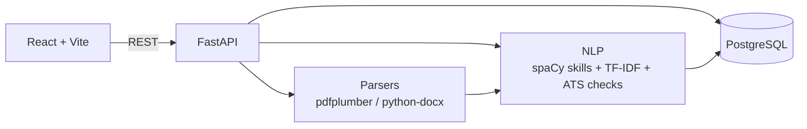
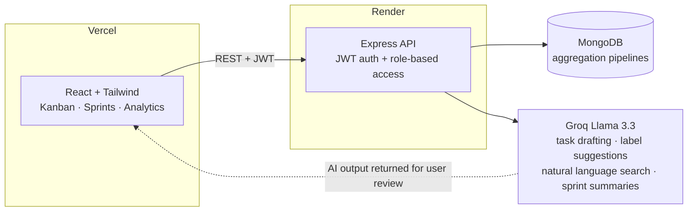

<!-- 1. Animated header (twinkling starfield) -->

<!-- 2. Typing animation -->

 

<!-- 3. Status badges -->

  

<!-- 4. Animated terminal intro (self-hosted) -->

<h2 align="center">▰▰▰ 👋 ABOUT ▰▰▰</h2>

I'm a third-year B.Tech CSE (Data Science) student who builds full-stack and AI-integrated products, from REST APIs and databases to deployment. I'm looking for **backend / full-stack / software engineering internships**.

- 🎯 **Career goal:** Software Engineer (Full-Stack)
- 💬 **Ask me about:** C++, DSA, MERN stack, Node.js, Express, MongoDB, PostgreSQL, REST APIs, Git, backend development
- 📄 **Resume:** [View resume](https://drive.google.com/drive/folders/1zLCd4_vI87wJ2ZP5tD5sI2nKt8ntizIu?usp=sharing)

<h2 align="center">▰▰▰ 🚀 FEATURED PROJECTS ▰▰▰</h2>

<!-- TODO: replace the Live / Code links below with exact URLs -->

| Project | What it does | Stack | Links |
|---|---|---|---|
| **HireSense** | AI-powered resume screening and candidate ranking with explainable ATS scoring (TF-IDF similarity plus an 88-skill spaCy taxonomy) | React, FastAPI, PostgreSQL, spaCy, scikit-learn | [Live](https://hiresense-sepia.vercel.app) · [Code](https://github.com/LakshayAggarwal12?tab=repositories) |
| **TaskFlow** | AI-enhanced project management platform: Kanban boards, sprints, role-based access, analytics, and 4 AI-assisted workflows | MERN, JWT, Groq Llama 3.3, Tailwind | [Live](https://github.com/LakshayAggarwal12?tab=repositories) · [Code](https://github.com/LakshayAggarwal12?tab=repositories) |
| **Nano-Nanny** | Team-built post-discharge healthcare platform with symptom logging and AI-generated health insights | MERN, Gemini API | [Live](https://github.com/LakshayAggarwal12?tab=repositories) · [Code](https://github.com/LakshayAggarwal12?tab=repositories) |

<h3 align="center">🧩 Architecture</h3>

<b>HireSense</b> architecture

<b>TaskFlow</b> architecture

<h2 align="center">▰▰▰ 🛠️ TECH STACK ▰▰▰</h2>

<b>💻 Core Stack</b>

<b>🧠 AI/Data</b>

<b>🧰 Tools & Deploy</b>

<h2 align="center">▰▰▰ 🏆 HIGHLIGHTS ▰▰▰</h2>

<table align="center">
  <tr>
    <td align="center" width="33%">
      <h3>🥇</h3>
      <b>Semi-Finalist</b> 
      Economic Times AI Hackathon 2026
    </td>
    <td align="center" width="33%">
      <h3>💼</h3>
      <b>AI Intern</b> 
      IBM Virtual Internship Built and deployed HireSense
    </td>
    <td align="center" width="33%">
      <h3>🧩</h3>
      <b>250+ DSA Problems</b> 
      LeetCode and GeeksforGeeks
    </td>
  </tr>
</table>

<h2 align="center">▰▰▰ 🎯 CURRENT FOCUS ▰▰▰</h2>

<h2 align="center">▰▰▰ 📊 STATS DASHBOARD ▰▰▰</h2>

  

📊 GitHub stats

  
  

<!-- 3D graph is generated by .github/workflows/3d-contrib.yml. Run that workflow once before this image appears. -->

  

<h2 align="center">▰▰▰ 🔗 CONNECT ▰▰▰</h2>

  
  
  
  
  

  ⭐️ Thanks for stopping by. Feel free to explore my pinned repos or drop a message via any link above.
   
  <a href="#about">↑ Back to top</a>

